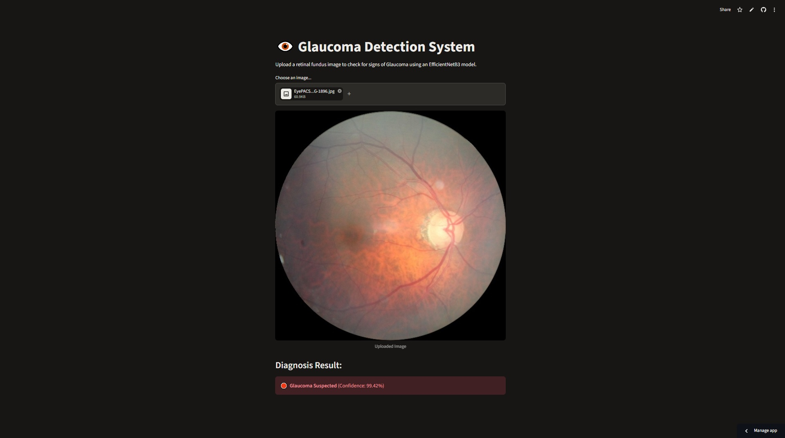
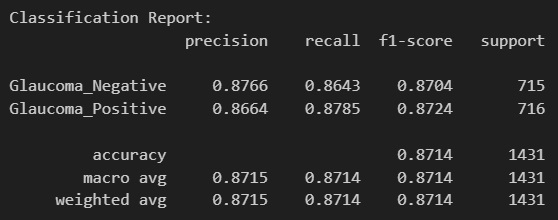
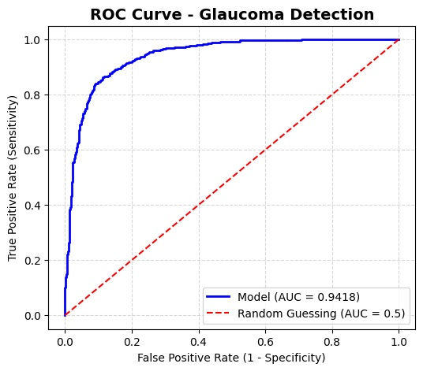

# 👁️ Glaucoma Detector

Glaucoma is a leading cause of irreversible blindness worldwide. It often progresses silently, showing no symptoms until significant vision loss has occurred. Early detection is critical, but manual screening by ophthalmologists is time-consuming and requires specialized expertise.

I developed an automated Deep Learning web application that screens retinal fundus images for signs of Glaucoma. By leveraging Transfer Learning, the system acts as a clinical decision support tool, instantly classifying an eye as **Normal / Healthy** or **Glaucoma Suspected** with high diagnostic confidence.

**🔗 Live Demo:** [Glaucoma Detector](https://glaucoma-ai.streamlit.app/)



---

## ⚠️ Important Usage Note: Full Retinal Image Required
For accurate predictions, the model requires a **full, uncropped retinal fundus image** (showing the optic disc, macula, and surrounding blood vessels). 
*   **Do not upload heavily cropped images** where the optic disc takes up the entire frame.
*   The model relies on the spatial context of the entire retina to make its decision. Cropping the image removes this context and can lead to false positives.

---

## 📊 Dataset
The model was trained and evaluated on the **[Glaucoma Dataset](https://www.kaggle.com/datasets/ismailfaridi/glaucoma-dataset)** available on Kaggle (a processed subset of the EyePACS dataset).
*   **Total Images:** 9,540
*   **Train Set:** 6,678 images
*   **Validation Set:** 1,431 images
*   **Test Set:** 1,431 images

---

## 🧠 Model Architecture
*   **Base Model:** **EfficientNetB3** (pre-trained on ImageNet).
*   **Fine-Tuning Strategy:** The base model was initially frozen, and the top **70 layers were unfrozen** for partial fine-tuning. This allows the model to adapt its generic ImageNet features specifically to the anatomy of the retina (blood vessels and optic disc).
*   **Image Preprocessing:** Raw images are enhanced using **CLAHE** (Contrast Limited Adaptive Histogram Equalization) to normalize varying lighting conditions before being fed to the network.

---

## 🏆 Results & Metrics (Test Set)

The model achieved excellent diagnostic power, successfully separating glaucoma cases from healthy ones.

*   **Accuracy:** 87.14%
*   **AUC-ROC Score:** 0.9415 (94.15%)
*   **Precision:** 86.64%
*   **Recall (Sensitivity):** 87.85%

### Classification Report & ROC Curve




## 🚀 How to Run Locally
To run this application on your own machine, follow these steps:
```bash
git clone https://github.com/ismailfaridi/Glaucoma-Detector.git
cd Glaucoma-Detector

pip install -r requirements.txt

streamlit run app.py
```

## 📁 Repository Structure
```bash
glaucoma-detector/
│
├── app.py                           # Streamlit web application
├── requirements.txt                 # Python dependencies
├── README.md                        # Project documentation
├── img/                             # Images
└── model/
    └── glaucoma_detector_EfficientNetB3_model.keras # Trained Keras model file
```

## 🛠️ Tech Stack
- **Deep Learning:** TensorFlow 2.21, Keras 3, EfficientNetB3
- **Image Processing:** OpenCV (CLAHE), Pillow (PIL)
- **Web Framework:** Streamlit
- **Data Manipulation:** NumPy, Scikit-learn